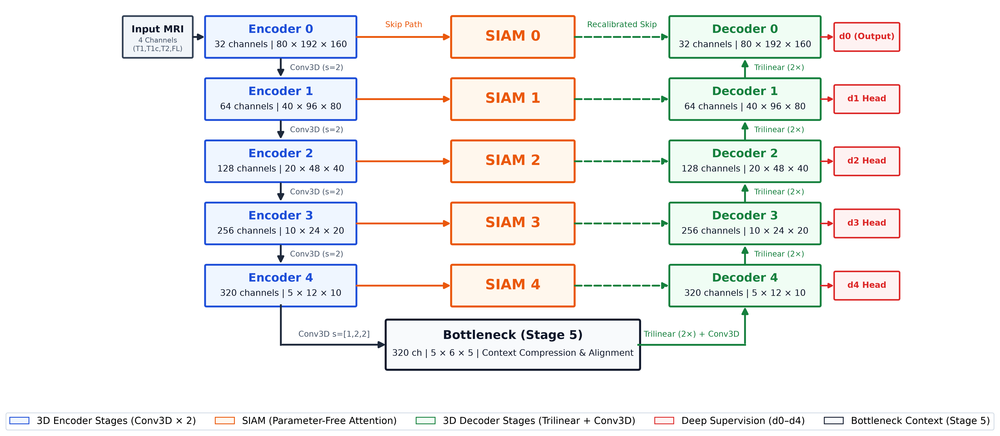

# Brain Tumor & Metastasis Segmentation on MRI (STAR-Net)
**BTP Phase 1 | Department of Electrical Engineering, Indian Institute of Technology Tirupati**  
*Author:* Roshan Kumar (EE23B009)

---



## Overview & Key Results

**STAR-Net** (**S**cale-**T**ransferred **A**ttention for **R**adiosurgery **Net**work) is an efficient 3D deep learning framework designed for multi-compartment brain tumor segmentation and sub-2mm stereotactic radiosurgery (SRS) margin delineation on multi-parametric MRI (T1, T1c, T2, FLAIR). 

Evaluating across a 15-model factorial ablation matrix on the **UCSF Brain Metastases Stereotactic Radiosurgery (UCSF-BMSR)** benchmark (412 patients, 448 clinical 3D MRI scans, 5,136 expert-segmented lesions; 418 scans via 5-fold cross-validation, and 30 strictly held-out test scans), STAR-Net achieves state-of-the-art boundary accuracy while dramatically reducing parameter overhead:

| Metric / Specification | Standard nnU-Net Baseline | MedNeXt-M Literature | **STAR-Net Flagship (M10)** | **STAR-Net Edge (Conf15)** |
| :--- | :---: | :---: | :---: | :---: |
| **Mean HD95 (Boundary Error)** | 9.40 mm | 7.90 mm | **7.80 mm** *(SOTA)* | **8.12 mm** |
| **Active Enhancing Tumor HD95** | 3.42 mm | 2.10 mm | **1.54 mm Median** *(< 2mm SRS limit)* | **1.71 mm Median** |
| **Mean Dice (All Classes)** | 77.20% | 79.10% | **79.85%** | **78.92%** |
| **Model Parameters** | 31.2 M | 14.8 M | 31.2 M | **1.49 M** *(95.2% reduction)* |
| **Checkpoint Size** | ~120 MB | ~58 MB | ~120 MB | **10.4 MB** |
| **Inference Latency (Full Volume)** | ~18.5 s | ~12.2 s | ~14.1 s | **2.4 s** *(RTX 2080 Ti)* |

> **Key Clinical Discovery — Task Asymmetry:**  
> Multiclass diagnosis requires Restored MRI (N4 bias correction + Non-Local Means denoising, **+8.66% Dice** by suppressing white matter noise), whereas Binary SRS margin delineation demands **RAW MRI** (spatial patch filtering inadvertently erases 2–9 voxel micro-metastatic nodules, incurring a **+3.13 mm HD95 penalty**).

---

## 1. Where to Start

If you are reviewing or taking over this project, please explore the primary documentation in the following order:

1. **[BTP_Phase1_Master_Presentation.pdf](BTP_Phase1_Master_Presentation.pdf)** *(or [PPTX source](BTP_Phase1_Master_Presentation.pptx)):*  
   **Main Entry Point.** A comprehensive 29-slide visual presentation detailing clinical radiosurgery context, 15-model progression ladders, 3D surface reconstructions, Grad-CAM attention visualizations, and hardware benchmarks.
2. **[BTP_Final_Report.md](BTP_Final_Report.md):**  
   Full technical documentation including mathematical derivations of Boundary-Aware Attention (BAA), Scale-Interaction Attention Module (SIAM), Inter-Level Hinge consistency loss, and tabular ablations.
3. **[BTP_IEEE_Report.pdf](BTP_IEEE_Report.pdf):**  
   Publication-ready 6-page IEEE conference manuscript.
4. **[Literature_vs_Our_BTP_Results_Comparison.md](Literature_vs_Our_BTP_Results_Comparison.md) & [Master Benchmark PDF](Literature_and_All_Configurations_Master_Benchmark.pdf):**  
   Direct head-to-head comparisons against literature baselines (nnU-Net revisited, MedNeXt, Saluja et al. 2024).

---

## 2. Repository Structure

```
Brain-Metastasis-Segmentation-STARNet/
├── README.md                                        # Project documentation (this file)
├── BTP_Phase1_Master_Presentation.pdf               # Master 29-slide presentation (PDF)
├── BTP_Phase1_Master_Presentation.pptx              # Master 29-slide presentation (PowerPoint)
├── BTP_Final_Report.md                              # Comprehensive technical report
├── BTP_IEEE_Report.pdf                              # IEEE format manuscript
├── Literature_vs_Our_BTP_Results_Comparison.md     # Literature vs BTP benchmark analysis
├── Literature_and_All_Configurations_Master_Benchmark.pdf
├── requirements.txt                                 # Python dependencies (pip, CUDA 12.1)
├── STAR_Net_Overleaf_Beamer.zip                     # LaTeX Beamer presentation archive
├── build_visual_master_presentation.py              # Automated builder script for PPTX slides
├── render_latex_equations.py                        # LaTeX math to high-res PNG renderer
│
├── src/                                             # Core PyTorch source code
│   ├── models/                                      # Network definitions (SIAM attention blocks)
│   ├── losses/                                      # Custom losses (BAA loss, curriculum scheduling)
│   ├── nnUNetTrainer_*.py                           # nnU-Net v2 custom trainers
│   ├── evaluate_*.py                                # Multi-metric evaluation pipelines
│   ├── prepare_*.py                                 # Dataset formatters and split generators
│   └── visualize_*.py                               # 2D/3D slice rendering utilities
│
├── metrics_csv/                                     # Quantitative evaluation spreadsheets
│   └── *.csv                                        # 25 per-patient and aggregate test metric CSVs
│
├── results/                                         # Visual presentation figures & diagrams
│   ├── presentation_figures/                        # High-resolution figures for slides
│   ├── architecture_diagrams/                       # Clean SVG/PNG vector network schematics
│   ├── predictions_test/                            # NIfTI segmentation test masks (.nii.gz)
│   └── qualitative_candidates/                      # Selected axial comparison slices
│
├── overleaf_beamer/                                 # LaTeX Beamer source files
└── scripts_archive/                                 # Multi-GPU cluster orchestration shell scripts
```

---

## 3. Environment Setup & Installation

The project uses standard Python virtual environments (no Conda required).

### Prerequisites
* Python 3.8+ (tested on Python 3.8.10)
* NVIDIA GPU with CUDA 12.1 support (tested on RTX 2080 Ti and DGX A100)

### Quick Setup

```bash
# 1. Clone repository
git clone https://github.com/roshankumarch2005/Brain-Metastasis-Segmentation-STARNet.git
cd Brain-Metastasis-Segmentation-STARNet

# 2. Create and activate virtual environment
python3 -m venv starnet_env
source starnet_env/bin/activate

# 3. Upgrade pip and install dependencies
pip install --upgrade pip
pip install -r requirements.txt
```

---

## 4. nnU-Net Environment Configuration

STAR-Net extends nnU-Net v2. Configure the required base environment paths before running training or testing:

```bash
export nnUNet_raw="/path/to/your/nnunet_data/nnUNet_raw"
export nnUNet_preprocessed="/path/to/your/nnunet_data/nnUNet_preprocessed"
export nnUNet_results="/path/to/your/nnunet_data/nnUNet_results"
```

---

## 5. Dataset Preparation (UCSF BMSR)

The dataset used is the public **UCSF Brain Metastases Stereotactic Radiosurgery (UCSF-BMSR)** benchmark:
1. Download the raw MRI scans from [TCIA UCSF-BMSR](https://www.cancerimagingarchive.net/).
2. Organize scans into the expected `data/` directory.
3. Run the automated formatting script to generate `Dataset100_Raw` for nnU-Net:
   ```bash
   python src/prepare_nnunet_data.py
   ```
4. Perform nnU-Net preprocessing and 3D fingerprint extraction:
   ```bash
   nnUNetv2_plan_and_preprocess -d 100 --verify_dataset_integrity
   ```

---

## 6. Evaluation & Inference

All quantitative results across the 30 held-out test patients can be verified using the scripts in `src/`:

```bash
# Evaluate test cases for all sweep configurations:
python src/fast_evaluate_test30_all_sweeps.py

# Evaluate Saluja et al. baseline reproduction:
python src/evaluate_saluja_test30.py

# Generate comparison metrics to CSV:
python src/evaluate_boundaries_to_csv.py
```

Per-case and summary spreadsheets for all 15 configurations are stored in [`metrics_csv/`](metrics_csv/).

---

## 7. Master Document Summary

| Document | Format | Description |
| :--- | :---: | :--- |
| [BTP_Phase1_Master_Presentation.pdf](BTP_Phase1_Master_Presentation.pdf) | PDF / PPTX | **Main Presentation**: 29 slides covering clinical motivation, architecture, and ablations. |
| [BTP_Final_Report.md](BTP_Final_Report.md) | Markdown | Full technical documentation and mathematical formulations. |
| [BTP_IEEE_Report.pdf](BTP_IEEE_Report.pdf) | PDF | 6-page IEEE-style conference paper. |
| [Literature_vs_Our_BTP_Results_Comparison.md](Literature_vs_Our_BTP_Results_Comparison.md) | Markdown | Detailed benchmarking against literature (nnU-Net, MedNeXt, Saluja et al.). |
| [Literature_and_All_Configurations_Master_Benchmark.pdf](Literature_and_All_Configurations_Master_Benchmark.pdf) | PDF | Consolidated tables comparing all 15 configurations. |

---

## Citation & Contact

Department of Electrical Engineering, Indian Institute of Technology Tirupati  
*Student:* Roshan Kumar (EE23B009)  
*Repository:* [https://github.com/roshankumarch2005/Brain-Metastasis-Segmentation-STARNet](https://github.com/roshankumarch2005/Brain-Metastasis-Segmentation-STARNet)
